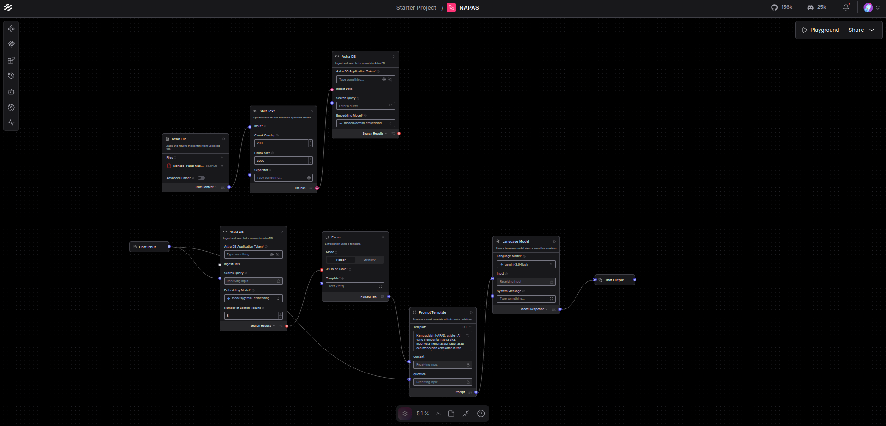

<p align="center">
  
</p>

# NAPAS: Smoke Haze & Wildfire AI Assistant

Hey there! This is **NAPAS**, a straightforward RAG (Retrieval-Augmented Generation) assistant built to help people deal with haze and wildfire (karhutla) issues in Indonesia. It pulls reliable answers straight from official Indonesian Ministry of Health documents so it doesn't just make things up.

I built this as a Capstone Project for the **Hacktiv8 x IBM SkillsBuild University Education** program.

---

## What's Inside the Repo?

```text
NAPAS/
├── assets/     # Screenshots (main canvas, prompts, playground previews)
├── docs/       # Official reference PDFs used for the knowledge base
├── src/        # The Langflow workflow export (.json)
└── README.md
